# 悠悠水族箱 V0.4｜觀察與課本複習整合報告

日期：2026-10-14（臺灣）。來源：`ff41009tw52-rgb/mimi-cream-farm`。

## 完成範圍與版本基準

從 main `a56c9719f323d2c8924f8510503db0bc0cb7e598` 的穩定 V0.3 延伸。開發前核對程式與遠端分支，沒有既有 V0.4 可運行入口；規劃截圖的勾選不作為完成證據。

| 原規劃項目 | 開發前實況 | 本次處理 |
|---|---|---|
| 水質與水中氧氣 | 有水質、髒污與清潔；沒有溶氧數值 | 保留水質，不新增氧氣模擬 |
| 過濾器與打氣機 | 未實作 | 不新增設備系統 |
| 魚缸小事件 | 未實作；成就不算事件系統 | 不新增事件 |
| 觀察魚兒 | 只有魚兒資料卡，沒有近距離觀察模式 | 本次完成三主題互動觀察 |

獨立入口：[V0.4](https://ff41009tw52-rgb.github.io/mimi-cream-farm/aquarium-v0.4.html)；[單檔版](https://ff41009tw52-rgb.github.io/mimi-cream-farm/aquarium-v0.4-standalone.html)。

保留 V0.1～V0.3、原始呼吸教學頁與其他網站檔案。沒有增加魚種、繁殖、疾病、AI、任務、背景音樂或問答測驗。

實作 commit：[`3321110eb97a66bbad81f584f3ab13cdab5a0909`](https://github.com/ff41009tw52-rgb/mimi-cream-farm/commit/3321110eb97a66bbad81f584f3ab13cdab5a0909)。分支：`feat/aquarium-game-v04`。報告與證據以後續 docs commit 加入同一 PR。

## A. 用詞修繕

逐項核對主畫面、商店、資料卡、圖鑑、設定、讀檔、送養、升級提示與無障礙名稱；程式變數與真正的 JSON 解析保持原樣。

| 原有文字／模板 | 新文字／模板 | 原因 | 程式位置 |
|---|---|---|---|
| `魚缸住客` | `魚兒數量` | 主畫面直接說明數量 | [aquarium-v0.4.html:24](aquarium-v0.4.html#L24) |
| `魚兒資訊` | `魚兒資料` | 資訊卡及無障礙名稱一致 | [aquarium-v0.4.html:32](aquarium-v0.4.html#L32) |
| `水族 Lv.1` | `水族等級 1` | 不用英文縮寫 | [aquarium-v0.4.html:25](aquarium-v0.4.html#L25) |
| `A LITTLE AQUATIC LIFE` | `一起照顧水中的生命` | 移除無意義英文 | [aquarium-v0.4.html:42](aquarium-v0.4.html#L42) |
| `魚兒資訊卡` | `魚兒資料卡` | 資料卡名稱一致 | [assets/aquarium-v04/aquarium.js:100](assets/aquarium-v04/aquarium.js#L100) |
| `水族 Lv.` | `水族等級 ` | 等級名稱一致 | [assets/aquarium-v04/aquarium.js:75](assets/aquarium-v04/aquarium.js#L75) |
| ``Lv.${s.unlockLevel} 解鎖`` | ``等級 ${s.unlockLevel} 解鎖`` | 商店短按鈕 | [assets/aquarium-v04/aquarium.js:167](assets/aquarium-v04/aquarium.js#L167) |
| `水族升到 Lv.${state.level}！` | `水族升到等級 ${state.level}！` | 升級提示易讀 | [assets/aquarium-v04/aquarium.js:151](assets/aquarium-v04/aquarium.js#L151) |
| `小住客的家` | `魚兒的家` | 魚兒用詞一致 | [assets/aquarium-v04/aquarium.js:117](assets/aquarium-v04/aquarium.js#L117) |
| `下一位小住客` | `下一隻魚兒` | 魚兒用詞一致 | [assets/aquarium-v04/aquarium.js:165](assets/aquarium-v04/aquarium.js#L165) |
| `送養這位小住客？` | `送養這隻魚兒？` | 送養語境 | [assets/aquarium-v04/aquarium.js:192](assets/aquarium-v04/aquarium.js#L192) |
| `可用 JSON 匯入` | `可用存檔檔案匯入` | 不要求學生認識檔案格式 | [assets/aquarium-v04/aquarium.js:65](assets/aquarium-v04/aquarium.js#L65) |
| `下載 JSON 進度，之後可以匯入。` | `下載進度檔案，之後可以匯入。` | 備份說明簡化 | [assets/aquarium-v04/aquarium.js:122](assets/aquarium-v04/aquarium.js#L122) |
| `支援 V0.1／V0.2／V0.4 JSON，先驗證再取代。` | `也能讀取舊版本的進度檔案，確認後再匯入。` | 完整支援舊版、避免工程術語 | [assets/aquarium-v04/aquarium.js:123](assets/aquarium-v04/aquarium.js#L123) |
| `清潔水族箱` | `清潔魚缸` | 詳細名稱一致 | [assets/aquarium-v04/aquarium.js:77](assets/aquarium-v04/aquarium.js#L77) |
| `藍紅光帶的小住客` | `帶著藍紅光帶的魚兒` | 魚種介紹一致 | [assets/aquarium-v04/aquarium-data.js:28](assets/aquarium-v04/aquarium-data.js#L28) |
| `V0.3 養成資料不完整` | `養成資料不完整` | 驗證涵蓋 schema 3 版本 | [assets/aquarium-v04/aquarium-save.js:37](assets/aquarium-v04/aquarium-save.js#L37) |

主畫面仍使用三個主要操作「餵食／商店／清潔」；詳細無障礙名稱用「清潔魚缸」。新增入口為資料卡「觀察魚兒」及頁尾「觀察與複習」，視窗名稱「魚兒觀察與複習」。新教材統一使用「外形與身體構造／游動／呼吸」，清楚區別鰓與鰓蓋。尚未存在的設備、氧氣警告與事件文字未憑空新增。

## B. 課本對照與科學核對

已讀取提供的圖片及完整規格。`image(4).png` 為規劃圖；`image(5).png` 與 `image(6).png` 為相同外形／游動課本頁；`image(7).png` 為呼吸頁。因此教材內容依兩張不同課本頁核對，沒有假稱三張不同課本頁。未將整頁課本圖片放進學生介面。

| 課本主題 | 遊戲複習內容 | 實作 |
|---|---|---|
| 外形與身體構造 | 頭、軀幹、口、鰓蓋與五種鰭的位置與用途 | 原創側面硬骨魚 SVG；點部位或名稱，單一高亮與一句說明 |
| 游動 | 身體、尾部、各種鰭協同前進、轉向、平衡 | 側面動畫＋俯視左右擺動；尾鰭／其他鰭／轉彎切換；方向箭頭 |
| 呼吸 | 口進水、流經鰓、由鰓蓋後方流出；取得溶解氧 | 口與鰓蓋協調開合、三個階段、半透明水流、鰓蓋透視 |

教材說明獨立於 `aquarium-observation-content.js`，方便教師修改。玩家魚預覽沿用真正魚種、配色、成長外形與游動姿態；可選魚、追蹤、放大。教材另標示「構造示意圖」，避免以同一外形冒充所有魚種。

科學核對：

- 胸鰭在頭後身體兩側；腹鰭在腹側中段；臀鰭在後段腹側；尾鰭在身體後端。點選與標線同屬 SVG 座標，縮放不會錯位。
- 鰓蓋覆蓋鰓。鰓以三層規則鰓弓／鰓絲示意，裁切於鰓蓋範圍內，透視時才清楚看到；不是魚外側的紅色線條。
- 水從左側口進入，經鰓後由鰓蓋後方流出；不是吸取水分子內的氧原子。口腔柔和藍綠，不出現黑洞；鰓蓋最大縮放約 16%，不向外誇張翻折。
- 游動同時呈現身體與鰭的配合，俯視圖展示側面圖不易看出的左右擺動。轉向時前進箭頭隨方向變化。
- 三階段為連續過程的教學拆解，不主張所有魚用相同節拍呼吸；明示不同魚種外形與游動方式可能不同。

除課本外，交叉核對 [南卡羅來納自然資源部：魚類構造](https://www.dnr.sc.gov/fish/anatomy.html)、[夏威夷大學：魚類構造與功能](https://manoa.hawaii.edu/exploringourfluidearth/biological/fish/structure-and-function-fish)、[美國國家公園署：水下呼吸](https://www.nps.gov/articles/blue-in-the-face-breathing-underwater.htm)。僅核對鰭功能、鰓蓋、溶解氧及水流方向，未引用整段原文。

## 存檔與時間隔離

- `schemaVersion: 3`、`gameVersion: "0.4"`；沒有為短期教學操作增加存檔欄位。
- 正常 `SAVE_KEY = aquarium_game_save_v4`；手動 `aquarium_game_save_v4_manual`。
- 測試 `aquarium_game_save_v4_test`，手動再加 `_manual`。
- 首次無 V4 時，依序讀 V3、V2、V1；先 validation，再沿用 1→2→3 migration，另存 V4。保留舊魚、名字、金幣、水質、成長、飽食、布置、容量、個性、配色與成就。
- 舊 key 不刪除、不覆寫。合法手動快照另外升級；V3 已領成就 ledger 合併至 V4。資料損壞時停止覆寫並提示；儲存失敗保護與多分頁衝突防護沿用。
- 觀察模組沒有另外啟動 RAF／setInterval，沒有每幀存檔。主迴圈每幀呼叫一次觀察 tick，0.5～2 倍只乘上示意時間。返回後停止觀察繪圖，遊戲持續正常成長。
- 同一瀏覽器與來源可自動承接；換裝置、換瀏覽器或不同 file:// 儲存隔離環境，使用原有匯出／匯入進度檔案。

## C. 實際執行截圖

以下為 Chromium 實際操作截圖，不是 mockup。完整[截圖瀏覽頁](docs/aquarium-v04/index.html)另有可點開原圖的目錄。長視窗可捲動；標示 detail 的圖為捲動至觀察區後截取，固定返回按鈕仍可操作。

### 1. 遊戲主畫面

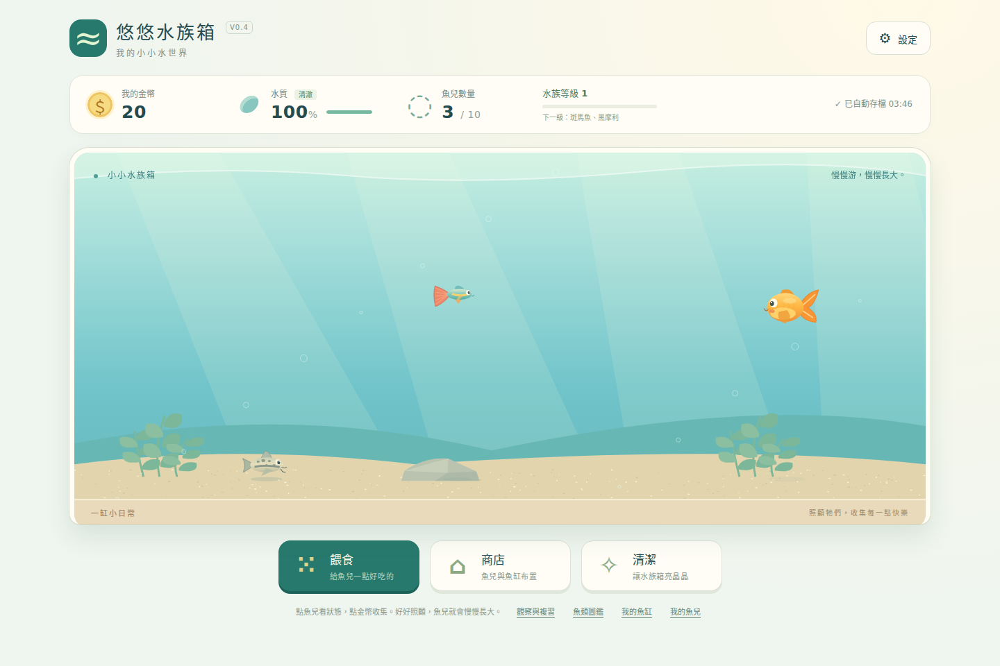

### 2. 魚兒資料與觀察入口

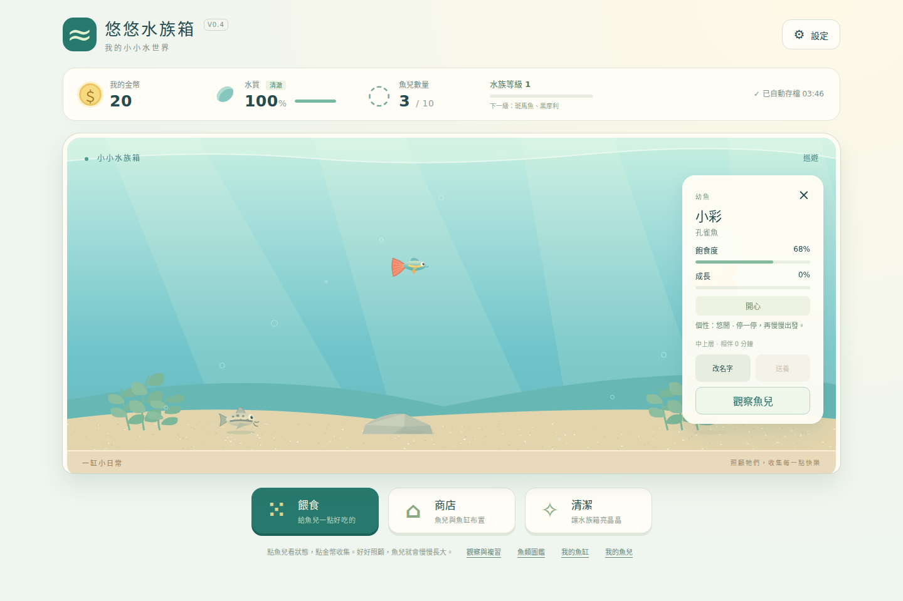

### 3. 三個觀察主題

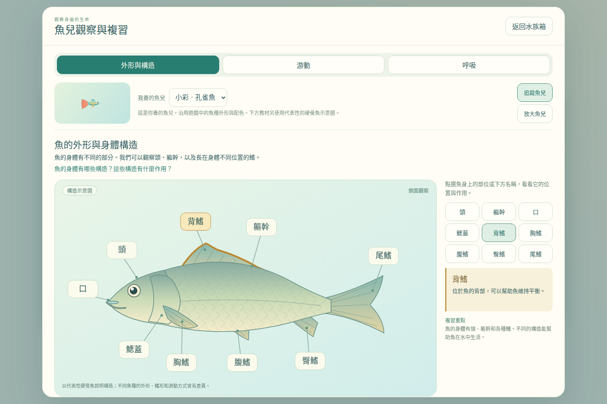

### 4. 外形構造：點選背鰭

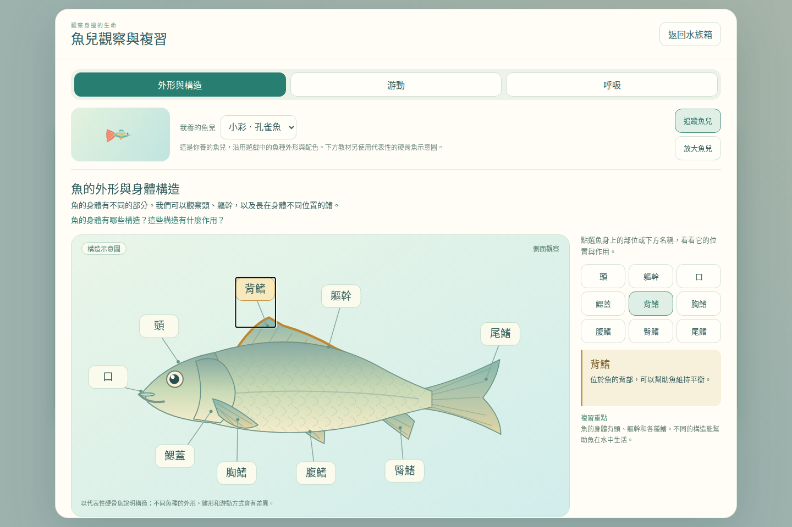

### 5. 外形構造：點選胸鰭

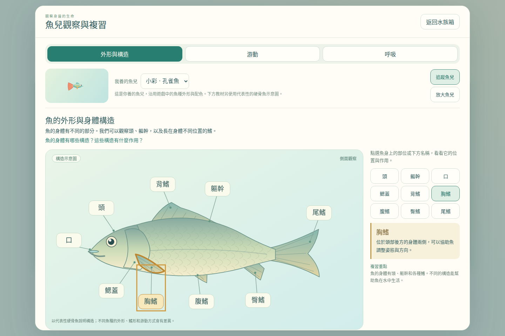

### 6. 游動與俯視左右擺動

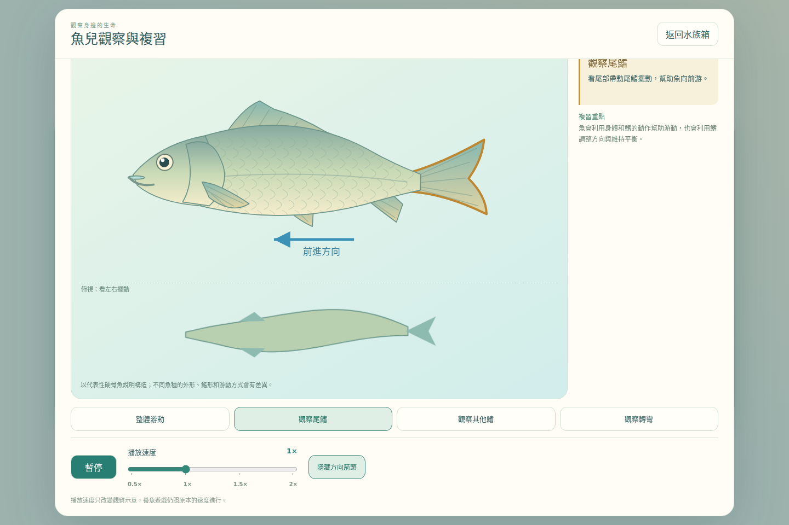

### 7. 觀察轉彎

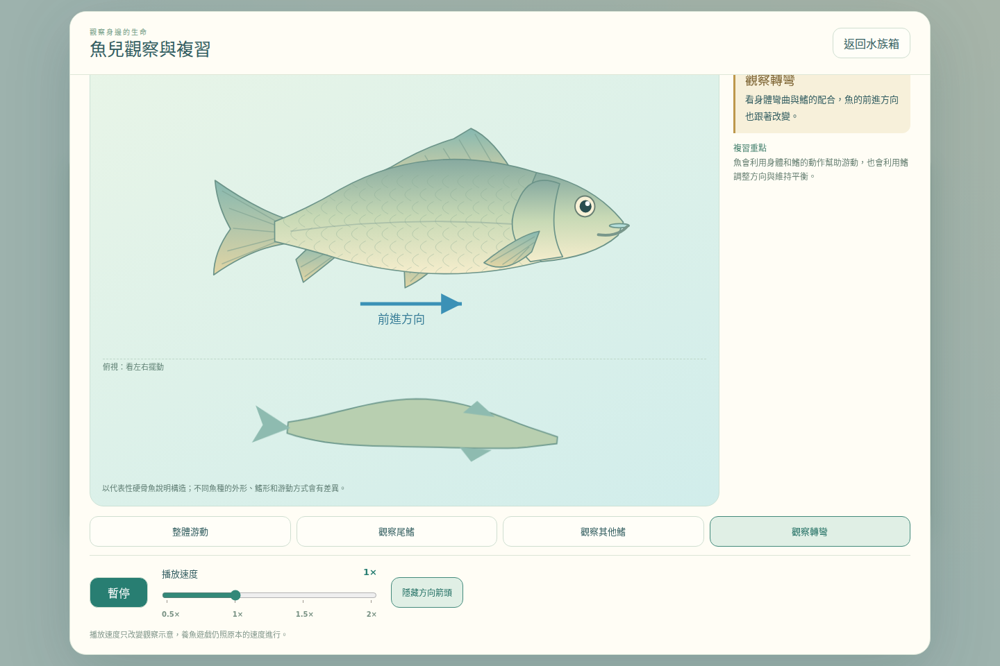

### 8. 呼吸：口與鰓蓋開合

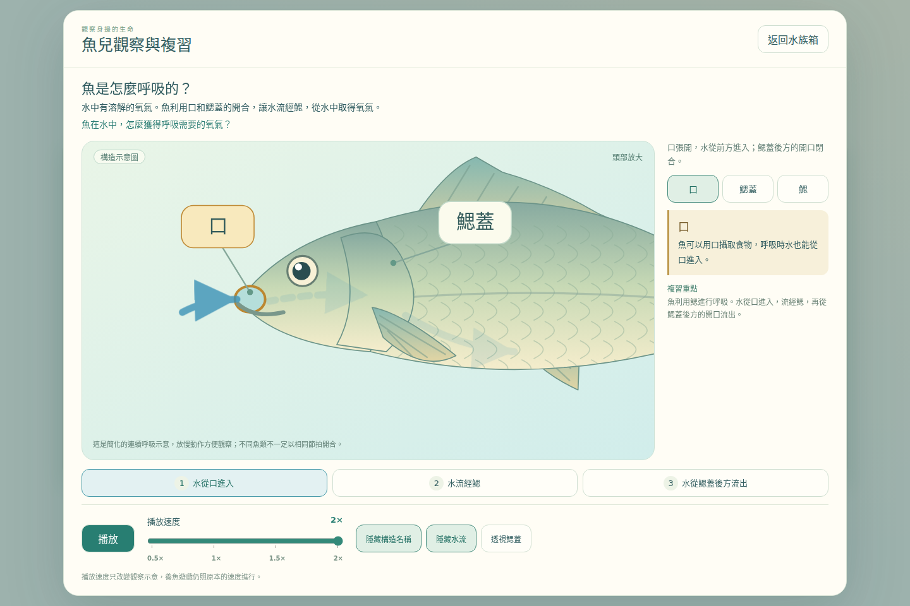

### 9. 鰓蓋透視與內部鰓

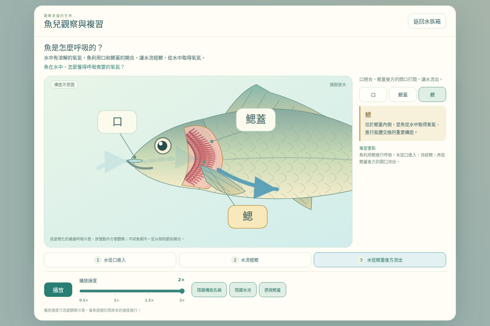

### 10. 1024×768：外形構造

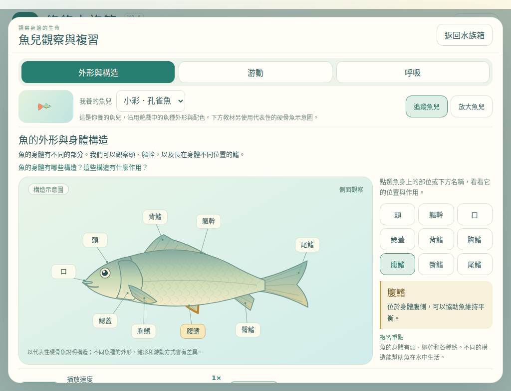

### 11. 1024×768：呼吸

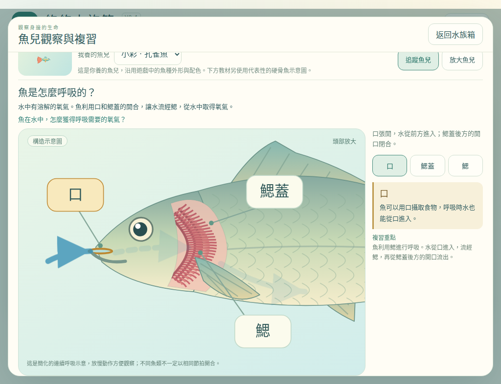

### 12. 820×1180：直式魚缸

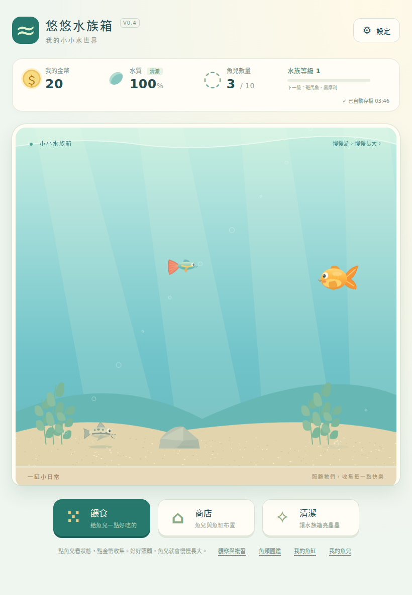

### 13. 820×1180：外形構造

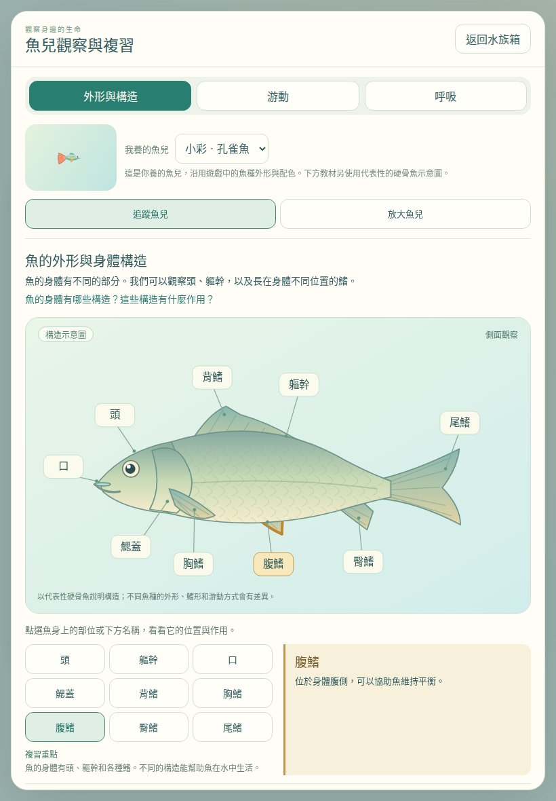

### 14. 820×1180：呼吸

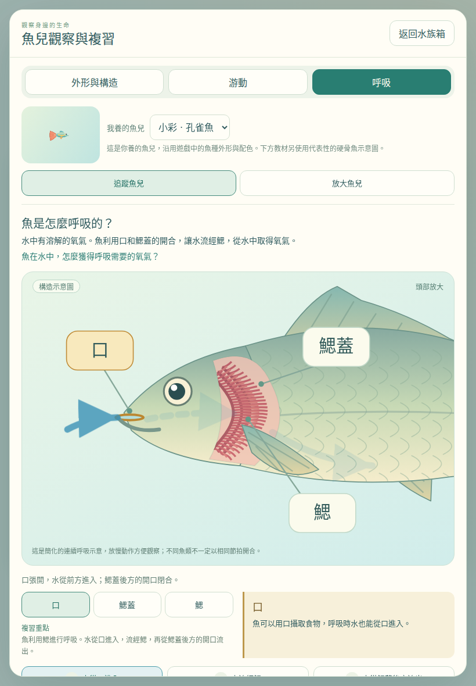

### 15. 390×844：手機呼吸操作

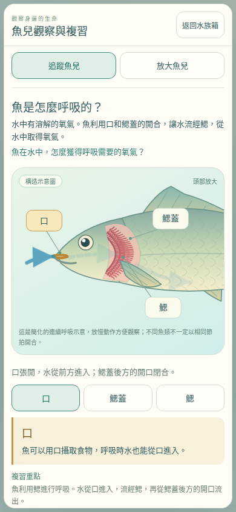

## D. 測試與修改紀錄

| 測試 | 實際結果 |
|---|---|
| schema 與 build | schema 1/2→3、舊容量、全欄位保留與拒絕非法資料；單檔與模組來源一致 |
| 原養魚功能 16 組 | 引導、購魚、10 魚種、升級、布置拖動／吸附／位置保存、配色與圖鑑、成就、改名、送養、音效開關、手動存讀、離線與快速模式通過 |
| 保存保護 9 組 | 配額失敗、原檔保護、手動復原、成就獎勵寫入失敗、每幀不存檔、版本重置隔離、損壞 ledger 通過 |
| 觀察 11 組 | 9 部位雙向點選、鍵盤、選魚、追蹤放大、游動／轉彎／箭頭、播放暫停、速度、呼吸三階段、透視／名稱／水流切換、重複進出、V3 升級及損壞原檔保護通過 |
| 遊戲速度隔離 | 同一進度、固定 10 秒，在 0.5×／2× 觀察下，魚成長、飽食、水質、產幣進度、金幣與主迴圈次數完全一致 |
| 平板與手機 | Chromium touch 模擬 1024×768、820×1180、390×844：三主題均可操作、44px 控制、無橫向溢出、返回正常 |
| 魚類行為 | 180 秒重現測試：快斑馬、慢金魚／神仙、鼠魚底層、個性、環境互動及沉底飼料行為保持 |
| 離線單檔 | file:// 真實 V0.2 自動／手動升級、刷新、觀察呼吸透視通過；無外部網路請求 |

效能：正常速度的真實 RAF 中，15 魚＋15 裝飾＋飼料＋金幣為 **60.0 FPS**，P95 幀間隔 **16.7 ms**，平均遊戲運算與繪圖 **0.57 ms**。三個觀察主題分別為 **60.0／60.0／60.0 FPS**。這是目前 Linux/headless Chromium 的量測，不等於每台平板的保證。

修正紀錄：實測發現共用 dialog 的背景 blur 在軟體繪圖環境使觀察降到約 26–28 FPS，已在觀察視窗明確覆寫為 `backdrop-filter: none` 並移除動態陰影，複測回到約 60 FPS。補上測試機繁體字型後重新產生截圖，避免「鰓」顯示缺字。另將短橫式平板的上方區塊縮緊，沒有縮小主遊戲魚缸。

測試原始結果：`docs/aquarium-v04/test-results/`。CI：`.github/workflows/test-aquarium-v04.yml`，執行語法、migration、單檔一致性與瀏覽器回歸，並保留測試 artifacts。

### 新增／修改檔案

本次新增以下程式、測試與建置檔；舊版均未修改：

- `.github/workflows/test-aquarium-v04.yml`
- `aquarium-v0.4-standalone.html`
- `aquarium-v0.4.html`
- `assets/aquarium-v04/README.md`
- `assets/aquarium-v04/aquarium-data.js`
- `assets/aquarium-v04/aquarium-observation-content.js`
- `assets/aquarium-v04/aquarium-observation-renderer.js`
- `assets/aquarium-v04/aquarium-observation.css`
- `assets/aquarium-v04/aquarium-observation.js`
- `assets/aquarium-v04/aquarium-save.js`
- `assets/aquarium-v04/aquarium-world.js`
- `assets/aquarium-v04/aquarium.css`
- `assets/aquarium-v04/aquarium.js`
- `scripts/build-aquarium-v04.py`
- `tests/aquarium/browser-v04-guards.test.cjs`
- `tests/aquarium/browser-v04-life.test.cjs`
- `tests/aquarium/browser-v04-observation.test.cjs`
- `tests/aquarium/browser-v04-standalone.test.cjs`
- `tests/aquarium/browser-v04.test.cjs`
- `tests/aquarium/schema-v04.test.cjs`
- `tests/aquarium/v04-harness.cjs`

另新增本報告、`docs/aquarium-v04/index.html`、15 張 `screenshots/*.png` 與 8 份 `test-results/*.json`。

### 發布與尚未實測事項

預定正式網址為本報告上方的 V0.4 獨立入口。PR 合併與線上檢查結果將記錄於 `docs/aquarium-v04/release-verification.md`，不能只用本機測試宣稱已部署。

本次規格的用詞與觀察複習功能已完成。水中氧氣、設備、小事件屬尚未實作的原規劃，依本次範圍保留，不補成整套系統。實體 iPad／Android 平板、Safari／Firefox、真人音效聽感及四年級學生課堂實測尚未執行；沒有宣稱這些已通過。
