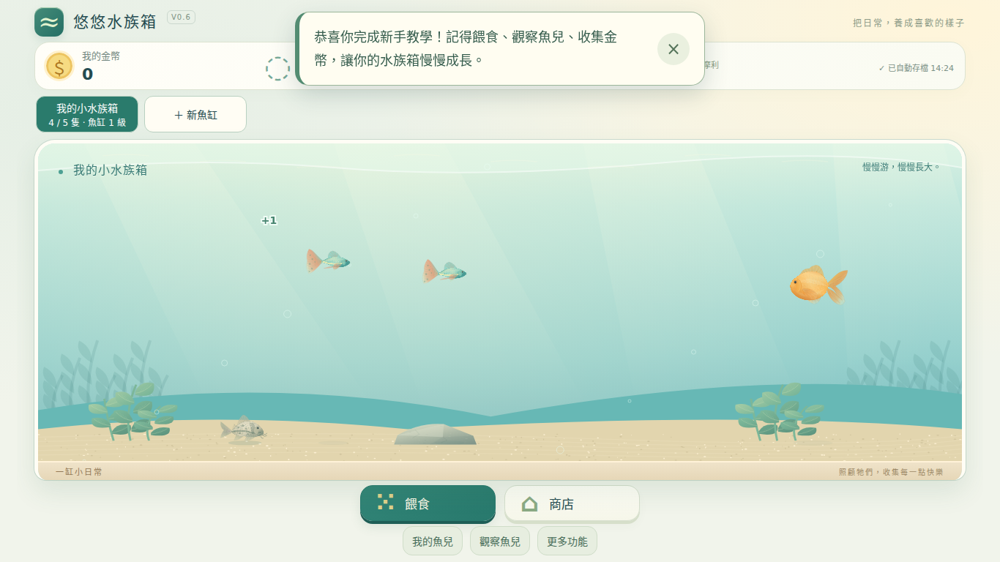
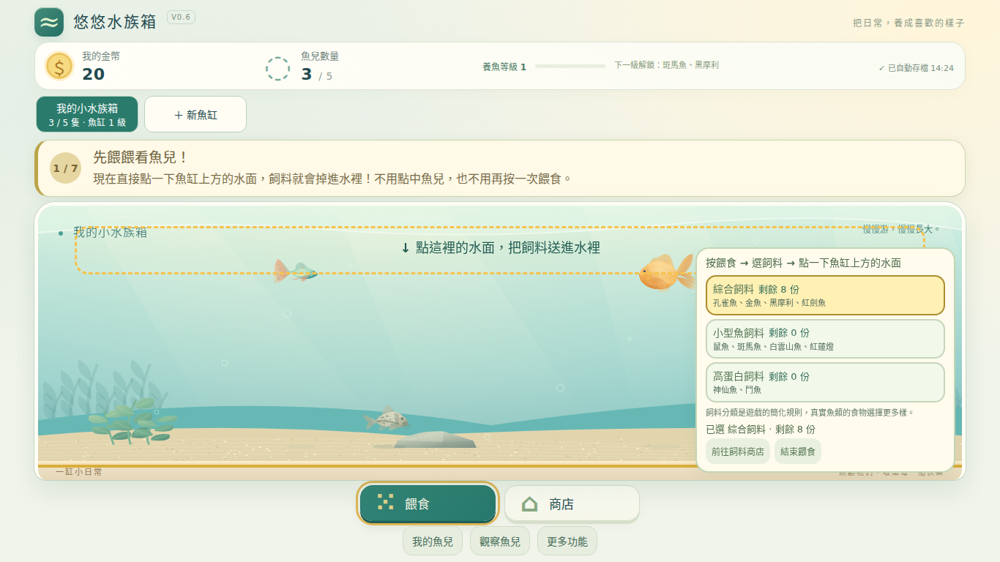
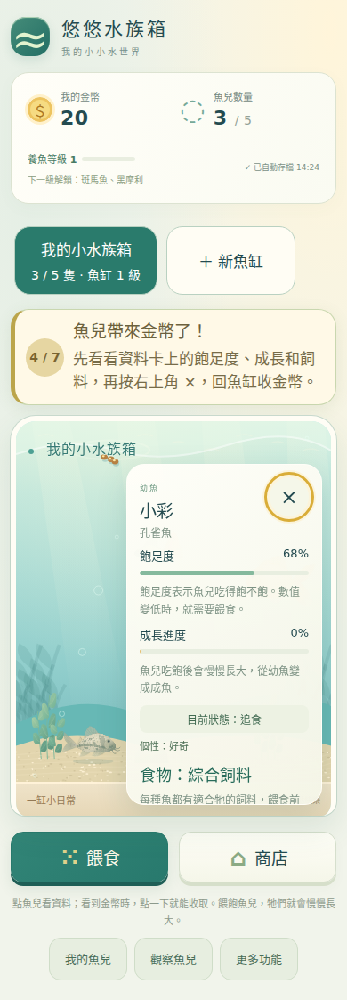
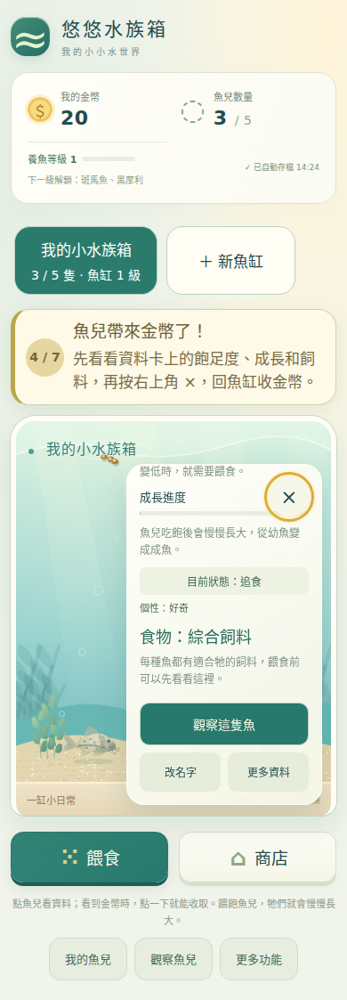
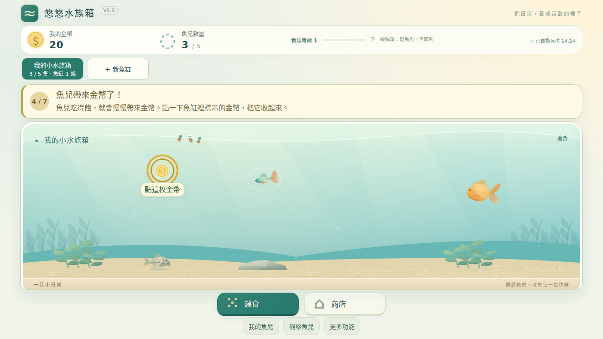
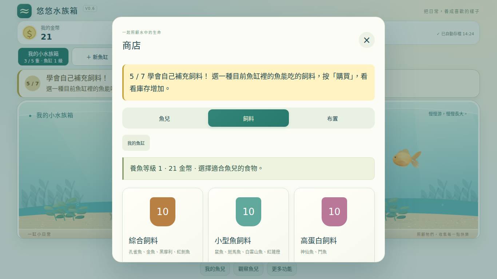
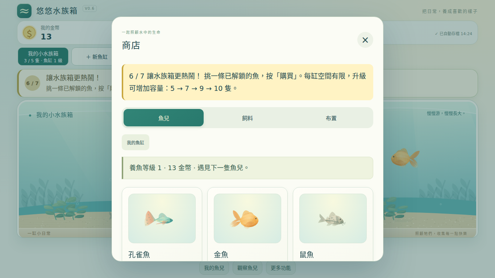
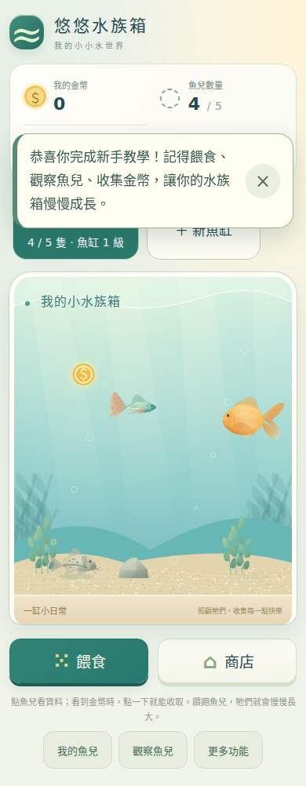

# 悠悠水族箱 V0.6｜布置美術與八項教學精修

本輪接續 PR #77 最新商品介面小修 `d2498abb18d64ec867492e18595d0feb041bf821`；main 基準 `dee16385554ae7c63550f0296aa867404b72da1d`。已確認舊輪 Actions `39349309267` 通過，並讀取舊工程報告、實際商店／手機遊戲截圖及現行測試。以下為 2026-10-20 新一輪工作；後方保留上一輪七任務報告作歷史紀錄，不能將其測試當成本輪結果。

## 本輪範圍

| 類別 | 內容 |
|---|---|
| 新增 | 第七項布置任務（購買並放置、進入調整、真正移位）、獨立 decorSupport 差額補助、無消費練習物件、升級／第二缸／移魚／備份首次提示、version 3 教學事件轉換 |
| 調整 | 12 項布置的共用 Canvas 繪圖、缸內底砂材質、手機預覽 Canvas 最小高度繼承造成裁切的修正、造景縮放比例、選取輪廓、方向鍵操作與不遮擋教學的補助訊息；保留原商品卡框架，只同步其內部物件與砂質呈現 |
| 原本完成並保留 | 三款 CSS/SVG 飼料袋、商品卡材質背景與收藏狀態、移除缸邊文字、前六項實際養魚流程、原觀察教材、十魚美術、4＋4＋2 食物規則、經濟、多缸、JSON／自動存檔／舊檔／多分頁保護 |
| 驗收狀態 | 最終功能提交 2e1644c 的 Actions 39358368359 全部通過；重新逐張檢視桌面、手機與平板實際截圖，60 張畫面已歸檔；未合併 PR #77，未改正式 V0.5 或 V0.4.2 |
| 未驗證 | 實體 iPhone、iPad、Android；低階實機長時間耗電與溫度；課堂學生實測。瀏覽器模擬觸控不視為實機。 |

## 逐項盤點與修改理由

正式名稱依 DECORATIONS，共 12 項。所有 ID、價格、收藏數量、原放置座標、前後層與魚兒環境互動標籤保留。實際截圖另找到手機商品 Canvas 繼承 340px 魚缸 min-height，導致圖案被預覽框裁掉；已限定商品 Canvas min-height:0 並新增框內完整顯示測試。沒有新增外部圖片或動畫。

| ID／名稱 | 原問題與保留項 | 本輪缸內精修（商品預覽共用造型） |
|---|---|---|
| river／河砂 | 原商品卡材質大圖可辨識；缸內使用同一套 340 粒分布，偏黃 | 暖米褐漸層、圓潤混合粗細砂粒、柔和沙紋，固定 270 粒 |
| white／白砂 | 商品卡辨識清楚；缸內與河砂共用粒形 | 米白與灰白、較細且稀疏的 180 粒、較寬淺色沙紋，避免純白 |
| black／黑砂 | 原缸內偏綠灰、同一粒形 | 黑灰深淺層、230 粒小角礫與細亮點；保持水色及魚輪廓對比 |
| smallplant／小水草 | 原本與高水草共用分枝造型 | 短莖蓮座、較寬葉片與中央新葉、低矮葉叢輪廓 |
| tallplant／高水草 | 不應只是小水草放大 | 長帶狀彎葉、不同方向捲曲、分層葉脈，原高度限制保留 |
| moss／莫絲 | 原多個圓形堆疊較像團塊 | 低矮密集細枝與三色枝葉，不增加搖曳動畫 |
| smallrock／小石頭 | 手機中扁小，與大石同形 | 圓潤卵石輪廓、柔和切面、細礦點，最低 24px 高 |
| bigrock／大石頭 | 明暗與小石區別不足 | 較高不規則岩體、明暗面、少量裂紋與苔色 |
| wood／沉木 | 原枝幹單一、木紋較弱 | 自然彎曲分叉、斷面年輪、順枝木紋與少量苔色 |
| cave／洞穴 | 原入口與外岩亮度相近 | 深色可辨識洞口、內壁亮邊、門檻與外岩塊面；保留躲藏互動 |
| ship／沉船 | 原完整帆形較像正常帆船 | 破碎甲板、裂船身、歪桅與缺角帆、舷窗及木板結構 |
| chest／寶箱 | 原共用綠灰材質削弱木箱感 | 暖木板、弧形箱蓋、側面、金屬箍／鉚釘／鎖孔；不加閃光動畫 |

商店卡的背景、標籤、排版與按鈕保留；底砂預覽仍保留原斜切材質塊外形，內部與缸內使用同一材質函式。物件預覽和缸內則完全呼叫同一 draw 函式。既有擺放不自動搬動；植物後層與底層造景可疊出景深，編輯時 DOM 選取框位於魚前方，至少 44px 觸控範圍。

## 八項任務與實際完成條件

| 任務 | 操作與完成條件 |
|---|---|
| 1 學會餵食 | 開餵食 → 選綜合 → 真正點水面投放；保留起始 ×8，扣一份生三顆 |
| 2 不同飼料 | 收小型 ×5 → 按餵食 → 選小型 → 真正投放 |
| 3 魚兒資料 | 真正開魚卡，顯示飽足、成長與食物說明；不發固定金幣 |
| 4 收金幣 | 真正使用原 collect 收取；無幣立即提供原安全示範機制 |
| 5 買飼料 | 開商店 → 飼料 → 真正扣款並增加庫存；沿用獨立缺額補助 |
| 6 買新魚 | 開商店 → 魚兒 → 新魚真正加入；沿用滿缸與複習保護 |
| 7 布置自己的水族箱 | 開商店 → 布置 → 真正購買且放入一件可移動裝飾 → 調整布置 → 選取並真正移至不同有效位置。指示小水草（35 金幣），不強迫買昂貴擺件。 |
| 8 科學觀察 | 真正開觀察模式；原鯉魚、魚鰭、呼吸與看看我的魚保留 |

第 7 項提示依次為「先按商店看看」「按一下布置」「選一件裝飾，購買並放置」「按調整布置」「選取後左右拖動」。可以觸控拖曳，也可以選取後使用 ←／→ 按鈕或鍵盤方向鍵。未移動、拖回原位置或位置不合適均不推進。

## 布置補助與防卡關

`decorSupport` 與 feedSupport、fishSupport 分開持久記錄。僅在第 7 項真正購買可移動裝飾、金幣不足且能放置時補「價格－持有金幣」。例：5 金幣買 35 金幣小水草，只補 30，再扣 35，剩 0；100 金幣則直接花 35，不領補助。補助成功訊息直接放在教學卡內，保留原操作指示，不再用浮動提示遮住下一步文字。贈禮帳本、差額、扣款、收藏、放入及事件證據採同一預寫交易；寫入失敗回復，頁面中斷由交易身分復原。

舊七任務存檔轉換後會保存 decorReuse 標記；即使只有起始布置，也能使用現有物件，不必再買。新進度若自行買過額外布置，也可直接複用。容量或位置不足改為查看流程並使用現有布置練習。複習不發物資、不補錢、不強迫消費：使用臨時練習水草移位，不寫入收藏或原布置，空缸也可完成。關閉商店／提早關閉調整模式只回到操作入口，不重置進度。

首次提示有獨立持久 hints，並與帳本合併：首次可負擔魚缸升級、等級 4 可開第二缸、擁有多缸且實際進入移魚功能、完成教學後的自動保存與下載說明。均可關閉，不要求購買或下載 JSON；複習完成後仍能收到尚未看過的首次解鎖提示。複習另保留原補助金額明細，不只保留已領取 ID。

## 存檔轉換

外層 schema 5 與原儲存鍵不變，教學獨立升為 onboarding.version 3。共 21 個操作事件；新五個 decor.* 事件插在 observe 之前。不是把舊 step 數字直接解讀為八項任務。

- 舊 version 2 的 0～14：保留已完成事件及既有補助；合理接續原任務。
- 舊 version 2 的 15：原養魚流程已完成，接第七項布置，再做科學觀察。
- 舊 version 2 的 16／已完成七項：維持完成，新增事件視為已通過，不強制重來。
- 更早 12 操作版與 V0.5：保留原事件轉換、18 魚拆缸、補償與裝飾保護；舊完成狀態不重新教學。
- gifts、金幣、飼料、各缸／魚／布置座標不重建；舊 JSON 會合併已領補助與提示，複習不重領。

## 效能方式

Canvas 繪圖仍在 buildBackground 與商品預覽時產生；平常魚兒游動只繪背景快取。每次底砂固定最多 270 粒，比原 340 粒少。植物無新增動畫，礦點與木紋都有固定上限。只渲染目前魚缸，未顯示魚缸沿用現有養成計算。新增 backgroundBuilds／backgroundMs 診斷，驗證連續游動不重建紋理；拖曳仍依原每影格合併更新。

## 本輪驗收與交付

功能提交 [`2e1644c138c03e2fa3fa5536e9521edaa73e9477`](https://github.com/ff41009tw52-rgb/mimi-cream-farm/commit/2e1644c138c03e2fa3fa5536e9521edaa73e9477)。[最終完整驗收 39358368359](https://github.com/ff41009tw52-rgb/mimi-cream-farm/actions/runs/39358368359) 已全部通過，包含 Chromium 與 Linux WebKit。以下均為本輪新測試，不沿用舊版通過紀錄：

| 類別 | 驗證內容 |
|---|---|
| 桌機 | 1366×768、1440×900，八任務、魚缸／按鈕單畫面及商店預覽框內顯示 |
| 平板模擬 | 1024×768、820×1180，商品名／預覽／購買按鈕、觸控選取與移動 |
| 手機模擬 | 390×844，砂與所有造景、觸控拖曳／移動按鈕、提示位置、60 秒真實計時動畫 |
| 資料與交易 | 舊 12 操作及七任務每個 checkpoint、完成免重來、已有布置複用、三類獨立差額補助、防重領、額度回復、交易中斷復原、匯入舊 JSON |
| 養成回歸 | 十魚／三種飼料、無庫存、錯食、救急、產幣、購魚、容量升級、多缸／移魚、原教材、離線版 |
| 效能 | 5／10 魚、三缸 30 魚與 12 件布置，兩分鐘模擬推進（每秒 10 次模擬更新）不重建背景；另 10 魚多造景連續 60 秒真實計時，不能將虛擬時鐘測量當成實際 FPS |
| 匯出匯入 | 實際下載並透過選檔匯入；保留購買、移位座標與補助紀錄 |

真實計時手機模擬：10 魚、多件造景連續 60 秒，平均 **59.99 FPS**、背景重建 **0 次**。5／10／30 魚兩分鐘虛擬推進也均為 0 次背景重建；虛擬時鐘中的 meanFrameCostMs=0 不是實際效能數字，不以此宣稱零運算成本。所有五尺寸商品框溢出檢查為 false，交易與瀏覽器錯誤清單為空。

### 2026-10-20 再次美術複核

逐張查看本輪 CI 原尺寸畫面：三款砂底的明度、色相及粒形有區別；小水草、高水草、莫絲的高低與葉型不相同；洞口具有深色內壁；沉木分枝、沉船破損、寶箱箱蓋與金屬箍可辨認。商店與缸內使用相同輪廓，手機造景預覽未再出現 340px 最小高度導致的裁切。桌機完整魚缸與主要按鈕維持單畫面，平板商品圖與按鈕未重疊。

手機缸內物件刻意保持低彩度且小於魚兒的主視覺；莫絲及木紋等細節在 390px 全缸畫面不如商品預覽明顯，但三種植物、洞穴及木製擺件的輪廓仍可區別。未為放大細節而遮住魚兒。手機全頁截圖可高於 844px，這代表正常捲動頁面，不代表強行縮小畫面；教學會自動定位操作目標。選取框與移動控制保持可操作，提示不覆蓋操作物件。

先前完整驗收 `39355955126`（功能提交 3469040）通過後，視覺檢查發現補助浮動提示會短暫蓋住手機教學文字，已將訊息移入教學卡，增加不遮擋檢查；最終 2e1644c 的新截圖再次確認修正成立。

第一輪 `39354125564` 的既有養成回歸、八任務五尺寸及截圖測試通過，但新增專項測試使用了錯誤的最外層布置欄位，因此整輪失敗；已改為讀目前魚缸陣列內的資料，不能把第一輪宣稱全部通過。檢視第一輪截圖又發現手機商品預覽繼承魚缸最小高度造成裁切，及矮缸石頭比例偏扁，均已修正並重新驗收。第二輪 `39355148512` 已通過手機商品框內顯示、差額補助、寫入失敗回復與鍵盤移動；但空缸測試移除白砂庫存時仍指定白砂，嚴格驗證器正確拒絕此不完整測試資料。已改用正式河砂起始組合，並在建立瀏覽器前先驗證測試存檔。被更新提交自動取消的過渡工作流程不列為通過。

本地未啟用額外預覽瀏覽器；本輪瀏覽器驗收及截圖由 GitHub Actions 的 Chromium／Linux WebKit 執行。模擬觸控使用瀏覽器輸入，WebKit 以觸控選取與輔助按鈕完成。沒有實體手機或平板驗證。

交付沿用 [V0.6 私人預覽](https://youyou-aquarium-v06-preview.ff41009tw52.chatgpt.site)，另提供 [60 張實際截圖驗收頁](https://youyou-aquarium-v06-preview.ff41009tw52.chatgpt.site/decor/)；原圖來自本輪 CI artifact 12236597061，SHA-256 已驗證，包含砂底、全種類造景、商店、八任務、補助與五種尺寸。版本庫內位於 `docs/aquarium-v06-decor/`，附 CI／效能／觸控 JSON 證據。

預覽部署與報告／截圖提交完成後才交付；GitHub Pages 公開入口未透過 main 更新。原正式 V0.5 及 main 不變；[PR #77](https://github.com/ff41009tw52-rgb/mimi-cream-farm/pull/77) 保持開啟，等使用者確認預覽，不合併。

---

# 悠悠水族箱 V0.6｜七項養魚任務驗收報告

本次直接接續 PR #77 分支 `feat/aquarium-v06-feeding-multitank`，基準提交 `1ac844653499ff9b9899c72d049e7c35ab9c8293`。保留 2026-10-19 上一輪介面小修，不重新開發 V0.5。正式 `aquarium-v0.4.html`、V0.5 與 V0.4.2 回退檔案沒有變動；不合併 main。

## 本次新增、本次調整與保留成果

| 類別 | 內容 |
|---|---|
| 本次新增 | 第 4 項實際收幣任務、即時示範金幣、第 6 項購魚任務、飼料／購魚獨立缺額補助、交易中斷復原、教學事件模型 version 2、七任務專用自動化與新截圖 |
| 本次調整 | 將 12 個操作整理成 7 項主要任務；魚卡不再送固定 10 金幣；飽足、成長與飼料說明直接放資料卡；成功訊息放教學卡內，避免蓋住下一個提示；滿缸與複習有不消費的安全流程 |
| 保留上一輪小修 | 移除找到操作位置／暫停／略過按鈕，新玩家必須完成；實際操作確認、高亮、自動定位、桌面單畫面、緊湊飼料面板、關閉後續接、離線版同步 |
| 原本就已完成 | 三種庫存飼料、十魚 4＋4＋2 對應、魚兒美術與游動、成長與產幣、商店、容量升級、多魚缸、移魚、布置、圖鑑、成就、原版鯉魚與呼吸教材、JSON、自動／手動存檔、多分頁防護 |
| 尚未驗證 | 實體 iPhone／iPad／Android、不同作業系統的原生檔案系統、學生現場使用與長期經濟研究。瀏覽器尺寸與觸控模擬不視為實機。 |

## 七項任務、文字與完成條件

畫面只顯示 `1 / 7` 至 `7 / 7`，不再將每次按鈕點擊算成一項大任務。內部保留 16 個有事件證據的操作檢查點。

| 任務 | 顯示標題／主要提示 | 必須完成的操作 |
|---|---|---|
| 1 學會餵魚 | 先餵餵看魚兒！／按餵食 → 選綜合飼料 → 點上方水面 | 收下綜合 ×8；真正開餵食、選綜合、點水面並投放。扣 1 份、產生 3 顆，成功投放就完成，不等魚吃到。 |
| 2 不同魚的食物 | 不同魚兒，吃的飼料也不同！／鼠魚吃小型魚飼料，再試一次吧 | 收下小型 ×5；真正按餵食、選小型、點水面投放。 |
| 3 觀察養成狀態 | 看看你的魚兒！／看看飽足度、成長進度與適合的飼料 | 點魚或從我的魚兒開資料卡，三類資訊與說明同時存在。讀完按 × 回魚缸，不發固定金幣。 |
| 4 收集金幣 | 魚兒帶來金幣了！／點魚缸裡標示的金幣，把它收起來 | 真正收取一枚金幣。已有金幣就使用它；沒有時立即提供安全示範，不等待自然產幣。 |
| 5 補充飼料 | 學會自己補充飼料！／先到商店試一次 | 開商店、選飼料分頁、買一包目前魚缸裡的魚能吃的飼料。扣款與庫存增加成功才完成。 |
| 6 買新魚 | 讓水族箱更熱鬧！／挑一條已解鎖的魚，看看價格再購買 | 開商店、選魚兒、成功買魚，新魚真正加入目前魚缸後返回魚缸。僅點購買或失敗不算完成。 |
| 7 科學觀察 | 觀察魚兒的身體與呼吸！／按觀察魚兒 | 成功開觀察模式。保留外形、魚鰭、原版鯉魚、呼吸與看看我的魚，不加考試。 |

水面文案明確說：「現在直接點一下魚缸上方的水面，飼料就會掉進水裡！不用點中魚兒，也不用再按一次餵食。」表面以原有虛線框標示。

完成文字：「恭喜你完成新手教學！記得餵食、觀察魚兒、收集金幣，讓你的水族箱慢慢成長。」之後自由遊玩。

資料卡直接說明：

- 飽足度表示魚兒吃得飽不飽，數值變低就需要餵食。
- 魚兒吃飽後慢慢長大，從幼魚變成成魚。
- 每種魚都有適合的飼料，餵食前先看看這裡。

手機資料卡可在卡片內捲動查看完整資訊；關閉用的 × 會保持可見，再回魚缸收金幣。示範金幣以透明圓框高亮，保留原本的金幣圖案。

## 物資、示範金幣與補助安全

| 紀錄 | 觸發與效果 | 防止重複 |
|---|---|---|
| starter | 新遊戲按收下後綜合 +8 | 每份 saveId 持久帳本；複習不發 |
| smallLesson | 第二項任務領小型 +5 | 獨立 ID；複習不發 |
| lessonGeneralRecovery／lessonSmallRecovery | 未完成基礎投餌、原贈禮已領且對應庫存為 0，補 1 份完成練習 | 每類每份進度一次；已完成的操作證據也合併到帳本，舊 JSON 不會重置成可重領 |
| demoCoin | 第 4 項沒有金幣時，在目前魚缸放一枚 1 金幣示範 | 固定 ID `tutorial-demo-<saveId>`，與魚缸及領取記錄一起保存 |
| demoCollected | 用原 `collect` 機制真正收取示範 | 一次收款；已領紀錄不因刷新／舊 JSON 清除。複習示範不產生金幣或 XP。 |
| feedSupport | 第 5 項成功買適合飼料，且金幣不足時補 `價格－現有金幣` | 一次；金幣足夠不發、不消耗資格；金幣、扣款、庫存、購買次數、進度同筆交易 |
| fishSupport | 第 6 項成功買已解鎖且可放入的魚，金幣不足才補差額 | 與飼料補助分開一次；先檢查等級、配色、容量，再補助／扣款／加魚 |
| tutorialComplete | 第 7 項完成 | 保護完成狀態，較舊 JSON 不強制重教；重看另標記 review |

例如 5 金幣買 8 金幣飼料，只補 3，再扣 8，剩餘 0；若原有 100，直接付 8 剩 92，不領補助。補助當下才顯示「金幣還差一點，已幫你補足這次需要的金額！」，不提前預告贈幣。

舊 `fishCard` 已領紀錄仍保留；原先拿到的 10 金幣不扣回，也不再呼叫該獎勵。新補助是兩個獨立、只在實際購買時使用的資格。

交易使用持久預寫快照：先寫包含領取 ID、金幣、物資／魚兒及事件進度的待完成交易，再同步主存檔。一般寫入錯誤會回復操作前狀態與帳本；若網頁在兩次寫入之間中斷，下次載入會依交易 ID 補完同一筆，不靠時鐘判斷，也不重新發補助。完成後清除待辦。手動快照額度失敗仍保留先前已成功的自動存檔。其他分頁收到主存檔或贈禮帳本更新會停止過期分頁寫入。

## 中途離開、滿缸與複習

- 關閉商店不重設進度，提示改指向商店，開啟後再指向需要的分頁／商品。
- 魚游走時可從我的魚兒選擇；目前是空缸時，可從名單切換至有魚的魚缸。
- 小螢幕會自動捲動至目標，資料卡關閉後才標示可收取的金幣。
- 新玩家不能略過或用重新觀看來重設；重新開頁、JSON 匯入會接續已完成事件。
- 購魚時目前滿缸而其他缸有空位，提供切換入口，再真正購魚。全部滿缸時明確改為查看購魚流程，不要求送養、強制升級或額外消費，也不假稱新魚已加入。
- 已完成玩家可複習：仍實際按餵食、選料、點水面、開魚卡與收幣；投放為不增加魚兒飽足度的練習，不扣飼料，購物改查看流程，不再贈物資／補助。零飼料、零金幣、滿缸也能完成複習。

## 正式舊進度轉換

外層保留 schema 5 與原存檔鍵；新增獨立 `onboarding.version = 2`，含 `events`、內部 `step`、`completed`、`everCompleted`、`review`、`supportAmounts`、`transactionId`。它不是把 12 步數字改成 7 步數字。

| 舊 12 步 checkpoint | 轉換結果 |
|---|---|
| 0～7 | 依原事件對照，保留已完成的兩種飼料操作與領取紀錄 |
| 8 | 已開魚卡，從新增的收幣任務開始；原持有金幣不變 |
| 9～11 | 保留已開商店、飼料分頁及已購買的事件；先補做新增收幣任務，之後不重做已完成的操作，再進入新增購魚任務 |
| 12／已完成 | 直接保持已完成，不強制開始七任務 |

新格式的 step 必須與第一個尚未完成的事件一致，錯誤或未知事件拒絕載入。既有 V0.1～V0.5 仍經原驗證器與 schema 5 魚缸轉換；18 魚仍免費安全分成 10＋8，裝飾、名字、成長、個性、配色、圖鑑、成就、舊升級權益與補償保留。

每個舊 checkpoint 0～12 都有不修改輸入、保留金幣與獎勵、轉換後再次驗證的測試；另有瀏覽器實際載入舊未完成／已完成存檔的測試。

## 保留的經營規則

| 飼料 | 每包／價格 | 對應魚種 |
|---|---|---|
| 綜合 | 10 份／8 金幣 | 孔雀魚、金魚、黑摩利、紅劍魚 |
| 小型 | 10 份／10 金幣 | 鼠魚、斑馬魚、白雲山魚、紅蓮燈 |
| 高蛋白 | 10 份／14 金幣，養魚等級 4 | 神仙魚、鬥魚 |

固定 4＋4＋2 是遊戲簡化規則，不是生物學上的絕對限制。相同投放與沉降動畫，不對應的魚不追、不吃、不增加飽足；未食用的飼料自然消失。沒有水質、清潔、死亡或繁殖。

魚缸 1～4 級容量 5／7／9／10，升級費 80／220／480；裝飾上限 12／15／18／20。第二缸等級 4、600 金幣；第三缸等級 5、1,400。獨立魚缸、共享金幣／飼料／等級／圖鑑，仍只繪目前一缸，背景養成與離線收益沒有重複計算。

## 本次新測試與畫面

功能提交：[634ab024412d3c1f42d225ad39af580af0f34182](https://github.com/ff41009tw52-rgb/mimi-cream-farm/commit/634ab024412d3c1f42d225ad39af580af0f34182)。[本次完整 CI](https://github.com/ff41009tw52-rgb/mimi-cream-farm/actions/runs/39204367451) **全部通過**；不以 `39200830434` 的舊成功紀錄代替本次結果。

本機已通過：七任務五尺寸完整流程、兩種飼料真正投餌、魚卡說明、無等待收幣、真正買料／加魚、足額不補助／缺額補助、補助存檔失敗回復、交易中斷復原、舊 JSON 保護、滿缸流程、已完成玩家零資源複習、完整離線七任務、13 個舊 checkpoint、既有 V0.5 回歸。本次 GitHub CI 也已全部通過：十魚實際吃對應飼料、三種庫存與商店、20 分鐘經濟模擬、30 魚／三缸進度與效能、JSON 與額度保護、七任務五尺寸全流程、Linux WebKit 觸控／原生選檔及原呼吸教材。實際 PASS 記錄列於 `docs/aquarium-v06-tutorial/ci-results.json`，完整本次 Actions 證據 artifact ID 為 `12165018671`。

| 裝置類型 | 尺寸 | 本次檢查 |
|---|---|---|
| 桌面 | 1366×768、1440×900，100% 縮放 | 七任務完整操作；標題／狀態／教學／完整魚缸／主按鈕／頁尾均在單畫面；魚缸高度未縮到 175px 以下 |
| 手機模擬 | 390×844 | 七任務完整操作、金幣觸控、閱讀與目標捲動、無水平溢位；允許垂直捲動 |
| 平板模擬 | 820×1180、1024×768 | 七任務完整操作、目標可達、無水平溢位；保留字級與觸控空間 |
| Linux WebKit | 390×844、820×1180 | 本次 CI 已通過模擬觸控餵食、購料、JSON 原生選檔與原呼吸教材 |
| 實機 | iPhone／iPad／Android | 未執行，不把模擬當實機 |

截圖與結果：`docs/aquarium-v06-tutorial/`。畫面來源與版本列於該目錄的 `gallery.json`，可在 GitHub 報告及私人預覽的教學截圖集中檢視。

## 本次實際畫面

## PR 與預覽

- [PR #77](https://github.com/ff41009tw52-rgb/mimi-cream-farm/pull/77)：接續原分支，不合併 main。
- [私人試玩](https://youyou-aquarium-v06-preview.ff41009tw52.chatgpt.site/)
- [本次七任務截圖集](https://youyou-aquarium-v06-preview.ff41009tw52.chatgpt.site/tutorial/)
- [程式與完整報告](https://github.com/ff41009tw52-rgb/mimi-cream-farm/blob/feat/aquarium-v06-feeding-multitank/aquarium-v0.6-report.md)

私人預覽使用獨立網域；測試舊進度時，先由原版本下載 JSON，再在預覽首頁匯入。正式 V0.5 與原儲存空間維持原樣。GitHub Pages 的 V0.6 檔案需待分支正式發佈才會提供；這次交付以未合併 PR 與私人預覽為準。
