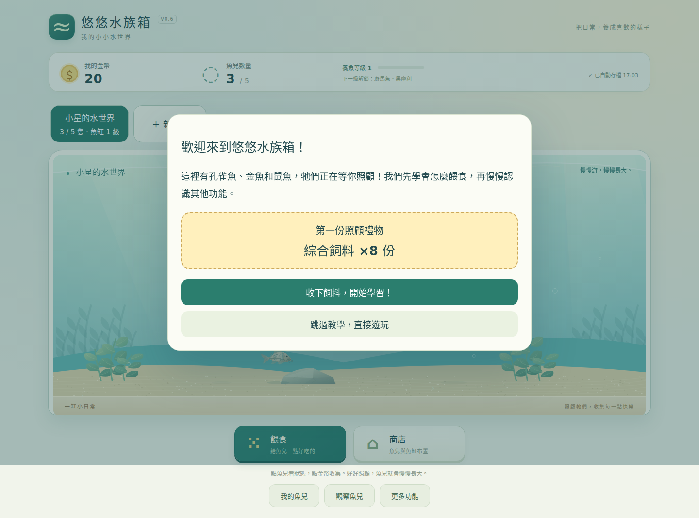
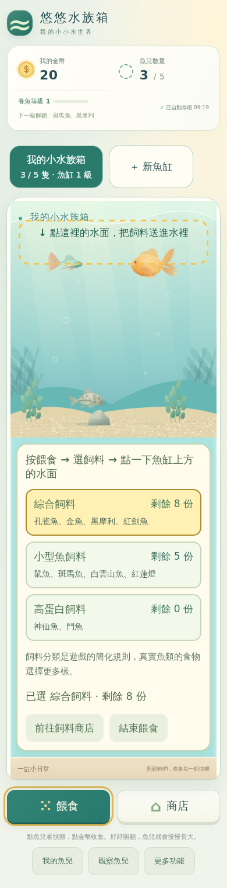
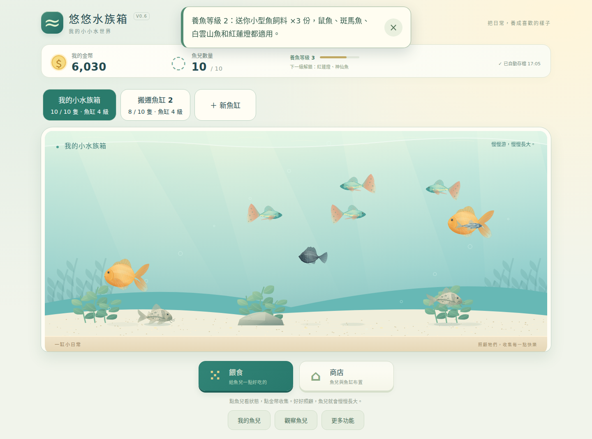

# 悠悠水族箱 V0.6 預覽版工程報告

以 main `dee16385554ae7c63550f0296aa867404b72da1d`（V0.5 正式版）為基礎。分支 `feat/aquarium-v06-feeding-multitank`。V0.6 為獨立預覽，不變更正式 aquarium-v0.4.html、V0.5 或 V0.4.2 回退頁。

## 飼料規格與十種魚

| 飼料 | 每包 | 價格 | 購買等級 | 固定魚種 |
|---|---|---|---|---|
| 綜合飼料 | 10 份 | 8 金幣 | 1 | 孔雀魚、金魚、黑摩利、紅劍魚 |
| 小型魚飼料 | 10 份 | 10 金幣 | 1 | 鼠魚、斑馬魚、白雲山魚、紅蓮燈 |
| 高蛋白飼料 | 10 份 | 14 金幣 | 4 | 神仙魚、鬥魚 |

| 魚種 | 可食用飼料 |
|---|---|
| 孔雀魚 | 綜合飼料 |
| 金魚 | 綜合飼料 |
| 黑摩利 | 綜合飼料 |
| 紅劍魚 | 綜合飼料 |
| 鼠魚 | 小型魚飼料 |
| 斑馬魚 | 小型魚飼料 |
| 白雲山魚 | 小型魚飼料 |
| 紅蓮燈 | 小型魚飼料 |
| 神仙魚 | 高蛋白飼料 |
| 鬥魚 | 高蛋白飼料 |

所有飼料使用相同投放與沉降速度，僅顏色不同；一次水面點擊扣 1 份並產生 3 顆。魚只追逐與吃對應食物，碰到其他食物沒有飽足度收益。分類是簡化遊戲規則，不代表真實魚類只能吃單一食物。殘餌自然消失，沒有水質、死亡或繁殖懲罰。

## 贈禮與實際操作步驟

歡迎卡片先送綜合飼料 8 份，按收下後才正式保存。流程：按餵食 → 選綜合 → 點水面 → 領小型魚飼料 5 份 → 按餵食 → 選小型 → 點水面 → 開魚兒資料卡（10 金幣）→ 開商店 → 飼料分頁 → 成功購買 → 進觀察模式。投餌成功就推進，不必等待魚吃到。

按餵食時不能跳過飼料選擇；點魚身不扣庫存，只提示點上方水面。實際按鈕高亮，投放區用透明箭頭框，提示 18–20px，商店內也有本步提示。可以略過、暫停、設定接續、重新觀看；略過仍取得基本兩類飼料。重看不重複贈禮。舊玩家不強制教學。

養魚等級 2 補送小型飼料 3 份；等級 4 解鎖並送高蛋白 3 份，已有高蛋白則只記錄解鎖、不重複加量。每種贈禮使用獨立 ID，狀態與每份 saveId 的持久帳本合併，避免讀舊 JSON／手動快照再領。存檔失敗時回復獎勵與庫存。

## 經濟循環與救急

保留 V0.5 的魚價、成長與產幣規則。飼料每份成本 0.8／1／1.4 金幣，一次 3 顆，每顆飽足度 13。初始三魚及 20 金幣保留。以正常模式推進 20 分鐘、每分鐘收幣的實際遊戲模擬，第 6 分鐘達到 65 金幣，第 20 分鐘有 338 金幣；三魚飽足度約 46.40，仍可正常產幣。此基準不額外投餌或買飼料，起始贈禮仍有綜合 8、小型 5 份；完整教學另驗證真正購買與扣款。綜合一包只需 8 金幣，未吞掉初期買魚資金，因此保留建議售價。600／1,400 金幣開缸價格定位為等級 4／5 的後期目標；已測試解鎖及扣款，尚未做學生長期遊玩研究。

全體魚中有某類飼料耗盡且金幣不足購買時，可在飼料店申請救急。每類至少 3 份，依需要照顧的魚數增加，足夠從飢餓恢復產幣。每份進度每 10 分鐘最多一次，以持久帳本記錄時間，刷新或載入較早 JSON 不會重置冷卻。

## 魚缸與多魚缸

| 魚缸等級 | 容量 | 升級費 | 養魚等級 | 裝飾上限 |
|---|---|---|---|---|
| 1 | 5 | 起始 | 1 | 12 |
| 2 | 7 | 80 | 2 | 15 |
| 3 | 9 | 220 | 3 | 18 |
| 4 | 10 | 480 | 4 | 20 |

第二缸：養魚等級 4、600 金幣；第三缸：等級 5、1,400 金幣。新缸為空缸且第 1 級。價格集中設定，初期最多三缸，資料為 tanks 陣列，可擴充規則。魚缸獨立命名、升級、魚兒、底砂、裝飾庫存與配置；金幣、等級、飼料、圖鑑及成就共用。

只渲染目前魚缸。其餘魚缸使用獨立暫態游動、飼料與環境目標，同步執行相同養成步驟；全體共用一次遊戲時計，避免經驗或離線收益乘上缸數。切缸保留已投餌；移魚有確認與目標容量檢查，保留魚 ID、名字、成長、飽足、個性、配色與紀錄。

## schema 5 與舊檔保護

持久內容：schemaVersion、saveId、coins、xp／level、feedInventory、feedPurchases、gifts、emergencyAt、onboarding、tanks、activeTankId，以及原圖鑑、成就與音效。每缸有 id、name、tier、fishes、drops、purchasedDecorations、placedDecorations、substrate。

V0.1–V0.5 先經原有驗證器再轉為 schema 5。新版使用獨立 `aquarium_game_save_v6`（測試模式另鍵），不刪除或覆寫 V0.5 鍵與快照。每缸魚數／裝飾上限、跨缸 ID 唯一、圖鑑總數與所有庫存均嚴格驗證。載入先預覽確認，失敗保留原進度，多分頁衝突會停止過期分頁。

舊缸先保留完整容量權益，免費轉成足量第 4 級魚缸：18 隻魚 → 10＋8。魚與裝飾不刪除，第一缸保留原裝飾（最多 20）。原大缸累積升級費為 0／400／1,950／6,750；新版第一缸升滿費用 780，超過部分補償：0／0／1,170／5,970 金幣，受既有金幣上限保護。移轉紀錄保留原金額與補償數，重新匯入舊檔是替換同份進度，不疊加補償。另送遷移飼料 20／15 份；已有神仙或鬥魚時補高蛋白 10 份。

## 新手操作與程式驗收對照

| 階段 | 玩家必須真正完成 | 程式確認／結果 |
|---|---|---|
| 歡迎贈禮 | 按「收下飼料，開始學習！」 | 綜合 +8，保存 starter 紀錄 |
| 第一種 A | 按真正的餵食按鈕 | 餵食選單已開啟 |
| 第一種 B | 選綜合飼料 | 明確選取 general，顯示庫存與對應魚 |
| 第一種 C | 點魚缸上方水面 | 實際生成 3 顆、庫存 -1，立即完成 |
| 第二份贈禮 | 領小型魚飼料 | smallLesson +5，獨立防重領 |
| 第二種 A | 再按餵食 | 選單重新開啟 |
| 第二種 B | 選小型魚飼料 | 明確選取 small |
| 第二種 C | 點水面投放 | 庫存 -1、3 顆；鼠魚可以尋食 |
| 認識魚兒 | 點魚／我的魚兒，打開資料卡 | 顯示名字、種類、飽足、成長、個性、食物與觀察入口；贈 10 金幣一次 |
| 第一次購買 A | 按商店 | 真正打開商店 |
| 第一次購買 B | 按飼料分頁 | 顯示名稱、魚種、份數、價格、庫存與購買按鈕 |
| 第一次購買 C | 成功買任一已解鎖飼料 | 扣款、增加 10 份、自動保存，才推進 |
| 科學觀察 | 按觀察魚兒 | 保留外形與構造、呼吸、看看我的魚；不強迫考試 |

歡迎贈禮為進教學前的卡片；後續程式狀態機有 12 個實際操作／贈禮步驟。點教學文字不會跳過操作。手機選好飼料會自動捲回水面；錯點只提示，不重設進度。

## 驗收結果與證據

功能提交：`6367cfc29e49a21627c34e2a3c588bb3c0e16643`。截圖與首輪完整 CI 的來源提交為 `3bceaeb79a53836914db5f5018f043b535bdf3fd`；後續只修正下述手動快照邊界，不變更正常遊戲畫面。完整自動化與截圖保留於 `tests/aquarium-v06/`、`docs/aquarium-v06/` 及 Actions artifact。

| 測試 | 結果與範圍 |
|---|---|
| schema／migration | V0.5 原測試與新版測試通過；18 隻安全分成 10＋8、免費容量、補償、裝飾、庫存、跨缸 ID、壞檔拒絕 |
| 飼料 | 三品種價格／庫存、1 份 3 顆、十種魚各別實際吃到、錯類不追不吃、零庫存、無適用魚確認、救急刷新冷卻通過 |
| 教學 | 全流程真正操作、禮物只一次、略過基本飼料、暫停／接續／重看、魚卡食物、購買與觀察通過 |
| 魚缸 | 5→7→9→10、滿缸拒絕、金幣不足拒絕、兩個空缸購買、命名、確認移魚、共用幣／料通過 |
| 多缸進度 | 三缸 30 魚皆推進、共用時計只加一次、背景進食、離線收益只給一次（原上限 120）通過 |
| 保存 | 全 30 魚 JSON 匯出入、錯檔不覆寫、讀舊快照不重領、匯入禮物帳本、額度失敗回復、多分頁衝突保護通過 |
| 原功能 | 原美術／呼吸素材雜湊保護、外形與呼吸畫面、離線完整 HTML 的 file:// 餵食及教材通過 |
| Chromium 四尺寸 | 1440×900、1024×768、820×1180、390×844 實際自動化畫面與互動通過，沒有頁面 JavaScript 錯誤 |
| 手機捲動 | 真正模擬觸控開選單→選料→自動回水面→投放通過 |
| 20 分鐘正常經濟 | 第 6 分鐘 65 金幣，第 20 分鐘 338 金幣，三魚仍能產幣 |
| 本機即時效能 | 30 魚／3 缸／每缸 20 裝飾、只繪一缸，在 390×844 Chromium 153 測得約 46.39 FPS，平均每幀工作 4.82ms；最終 CI 同情境約 60.14 FPS／1.21ms。兩者皆為容器基準，不能代表所有手機 |
| Linux WebKit | GitHub Actions Linux WebKit 在 390×844、820×1180 真正模擬觸控餵食、買料、下載與原生選檔匯入、原呼吸教材均通過；無頁面錯誤 |
| 實體裝置 | **未執行 iPhone／iPad／Android 實機測試**；尺寸與觸控模擬不視為實機 |

本次測試曾發現鼠魚在水面投餌距離較遠時無法及時尋食，已將所有符合飼料種類的魚之搜尋範圍延伸至魚缸範圍，保留原游動行為與相同飼料沉降速度。另補強匯入禮物紀錄的持久合併及存檔失敗後魚兒繪圖狀態回復。

PR 自動審查指出：自動存檔成功、手動快照失敗時可能回復較舊記憶體狀態。已將自動存檔提交狀態在第一筆成功時立刻更新，後續手動快照失敗會保留最新自動存檔與原手動快照，並顯示明確提示。新增真正模擬僅手動鍵超出儲存額度的測試，確認畫面狀態、最新自動存檔及重新整理後完全一致；本機回歸與修正後完整 CI 均通過，審查討論已解決。

## 實際畫面

完整 22 張畫面可由下方截圖集開啟；來源、尺寸與 CI 提交記錄在 gallery.json。

## PR、預覽與交付

- [PR #77](https://github.com/ff41009tw52-rgb/mimi-cream-farm/pull/77)
- [功能 Commit](https://github.com/ff41009tw52-rgb/mimi-cream-farm/commit/6367cfc29e49a21627c34e2a3c588bb3c0e16643)
- [手動存檔修正後 CI](https://github.com/ff41009tw52-rgb/mimi-cream-farm/actions/runs/39021293680)：全部通過，包含手動快照額度保護
- [首輪完整功能 CI](https://github.com/ff41009tw52-rgb/mimi-cream-farm/actions/runs/39020418676)：全部通過
- [獨立私人預覽](https://youyou-aquarium-v06-preview.ff41009tw52.chatgpt.site/)
- [實際遊戲、手機與平板截圖集](https://youyou-aquarium-v06-preview.ff41009tw52.chatgpt.site/screenshots/)
- 原始截圖／結果索引：`docs/aquarium-v06/gallery.json`、`v06-results.json`、`extra-results.json`、`webkit-results.json`；22 張實際截圖。
- 獨立入口：`aquarium-v0.6.html`；完整離線入口：`aquarium-v0.6-standalone.html`。

預覽使用獨立網域，瀏覽器進度不會自動從 GitHub Pages 帶入；要測試舊進度，請先在 V0.5 匯出 JSON，再於預覽首頁選擇匯入。原 V0.5 存檔與正式入口維持原樣。

正式入口不在本次預覽 PR 更新範圍；本 PR 不合併到 main，驗收後再安排正式發佈。

## 2026-10-19｜教學介面精簡與桌面高度微調

依最新試玩回饋，在同一 V0.6 預覽分支完成以下局部修正：

- 移除新手教學中的「找到操作位置」「暫停教學」「略過教學」三個按鈕，歡迎視窗也不再提供略過。教學仍由真實操作事件推進；網頁中途關閉後保留進度，重新載入自動接續；既有已完成的存檔不強制重教。
- 原本「找到操作位置」的手動功能改成每次進入新步驟時自動將螢幕外的目標捲進可視範圍。保留高亮與水面投餌框。
- 將 12 個操作子步驟中的文字縮短、明確說「按餵食 → 選飼料 → 點魚缸上方標示的水面」，移除提前宣告「完成後送 10 金幣」的文案。三種飼料屬於遊戲簡化分類；避免當作真實魚類只能攝取單一飼料的絕對說明。
- 在魚兒資料卡增設簡單的飽足度和成長提示；首次金幣提示明確教學生點魚缸裡的金幣；商店飼料分頁的底部說明修正為飼料庫存，而不再顯示布置提示。
- 重新排列桌面遊玩畫面：只在視窗寬至少 1060px、高至少 680px 時，以 flex 高度分配讓標題、狀態、教學、魚缸與操作鈕適應 `100dvh`；桌面選飼料面板縮成魚缸內的緊湊浮層。手機保留捲動與足夠字體，避免強行縮小魚缸。
- 同步模組版 `aquarium-v0.6.html`、完整離線版 `aquarium-v0.6-standalone.html`，並更新 Chromium／WebKit 測試中的略過教學操作。另增加 1366×768、1440×900 不需垂直捲動的自動化檢查。

**保留待後續跨模組開發的需求：** 12 步重新整合成七個主要任務、購魚新手教學、新手購買時才發放的金幣補助。這些牽涉教學狀態機、經濟與存檔遷移，本輪不變更；原有在打開魚兒資料卡時送 10 金幣的程式仍暫時保留（只是移除提前宣告的文字）。

本節記錄程式修改；本次提交後的 CI／視覺驗收結果應另外核對，不能以舊版 V0.6 通過結果充當本輪驗收。
