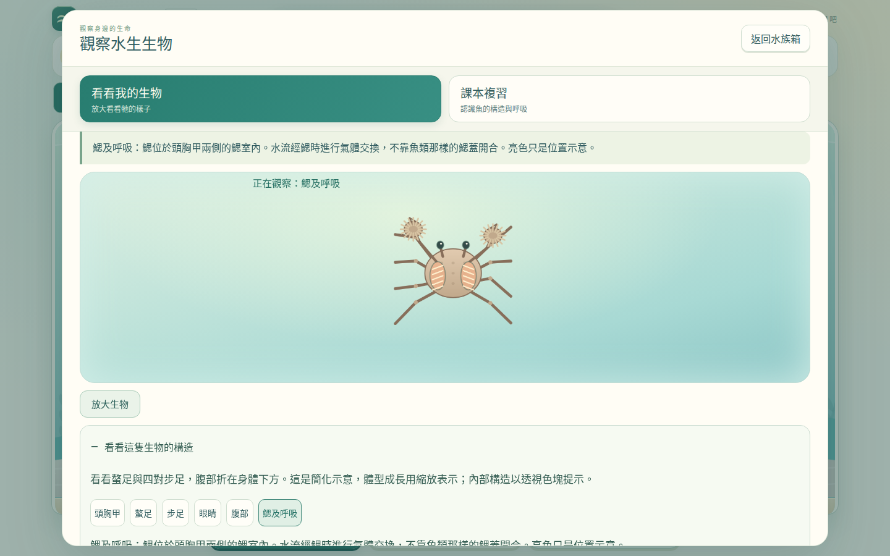
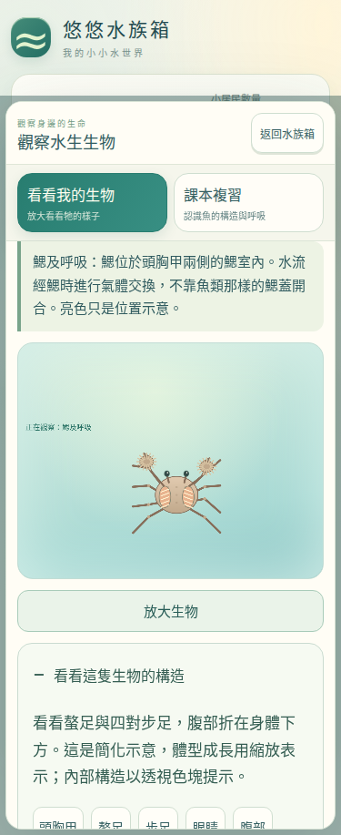

# 悠悠水族箱 V0.6｜2026-10-23 蝦蟹與操作改善

## 後續介面修正

- 小居民數量與升級魚缸按鈕以獨立排列保留明確間距；窄螢幕自動換行，更新魚缸圖示與薄荷綠按鈕外觀。
- 依使用者要求移除「全部收取」，同步移除 V0.6 事件與狀態更新；保留逐枚點金幣。模組版與離線版同步更新。
- 新增五種尺寸的間距檢查，正常玩家流程改為逐枚收幣，既有存檔格式與遊戲數值維持原狀。

## 本輪變更

以 PR #80 既有的升級入口與存檔修復續作。正式入口維持 `aquarium-v0.6.html`，沿用 15 種魚、24 種布置、三個主要操作與八項新手任務。

- 小居民數量旁可查看魚缸升級；列出目前/下一級容量、所需等級、價格、現有金幣與差額。符合條件、滿缸有不同提示，各缸獨立升級。升級走既有可復原交易，存檔失敗不回報成功。
- 「更多」顯示可領獎數量，成就頁將未領獎項置前，區分可領、未完成、已領。商店可直接前往領獎。
- 生物購買頁保留「魚兒」主分頁，增加全部/魚類/蝦類/蟹類篩選；卡片顯示飼料、價格、解鎖與金幣/容量狀態。既有布置卡未增加新預覽功能。
- 初版曾加入「全部收取」，後續已依使用者回饋移除（見上方介面修正）。
- 新增四種生物的獨立 Canvas 外形、關節附肢動畫，以及底砂行走、水草/沉木攀爬、停留覓食、躲藏；蝦類偶爾短游並避讓靠近的魚。原魚類游泳模型保留。
- 沿用原觀察視窗，新增蝦/蟹專屬構造名稱及高亮。鰓與蟹腹部以位置示意/透視色塊表示，不冒充可見的外部構造。仍可返回原鯉魚構造與呼吸複習。
- 支援命名、成長、攝食、轉缸、免費送養、保存/續玩；不提供出售獲利。

## 生物與價格

| 生物 | 等級 / 金幣 | 遊戲飼料 | 外形與動作 |
|---|---|---|---|
| 黑殼蝦 | 1 / 35 | 小型魚飼料 | 褐色、分節腹部與觸角；底砂覓食、水草停留、偶爾短游 |
| 藍蝦 | 2 / 95 | 小型魚飼料 | 藍色米蝦；植物與沉木攀爬、停留探索 |
| 迷你蜘蛛蟹 | 3 / 180 | 小型魚飼料 | 小頭胸甲、細長步足；慢步、攀附、躲藏 |
| 拳擊蟹 | 4 / 280 | 小型魚飼料 | 毛束螯足；底砂/石面行走、揮螯、處理食物 |

原升級 80/220/480 金幣、容量 5→7→9→10、第二/三缸 600/1400 金幣、三飼料每包 8/10/14 金幣，與既有生物價格/產幣數值均不變。

## 成就與金幣

既有 16 項成就、320 金幣總額與特殊配色保留。新增 10 項，合計 145 金幣；全成就可領金幣總額 320→465。

| 新成就 | 金幣 |
|---|---:|
| 第一次投放合適飼料 | 5 |
| 第一次資料卡 | 5 |
| 第一次收幣 | 5 |
| 第一次買飼料 | 10 |
| 第一次自己買並放置布置 | 10 |
| 第一次自由觀察 | 10 |
| 第一次養蝦 | 15 |
| 第一次養蟹 | 20 |
| 第一次觀察蝦蟹 | 15 |
| 收藏四種蝦蟹 | 50 |

不回補已領舊獎，也不重複發放新獎。既有魚類收藏/購買/成魚目標不使用新增蝦蟹湊數；歷史完成狀態保留。新活動紀錄獨立於可重看的教學進度。

正常模式自動遊玩以虛擬時間運行，沒有注入存檔、金幣、等級或使用測試模式；每次 UI 操作另計 1.5 秒。完成教學後實際領取成就並購買黑殼蝦，再靠餵食、收幣與成就進行首次升級。這是固定操作路線的模擬結果，不代表學生閱讀與決策時間。

| 里程碑 | 模擬經過分鐘 |
|---|---:|
| 首次買飼料 | 0.45 |
| 首次買魚 | 0.55 |
| 首次買布置 | 0.65 |
| 首次買蝦蟹（黑殼蝦） | 1.20 |
| 首次升級魚缸 | 4.48 |

## 科學內容與來源

- 藍蝦採 *Neocaridina davidi* 藍色觀賞品系，黑殼蝦使用 *Neocaridina* 屬褐色概括，註明俗名可能包含多種蝦；不把藍蝦畫成螯蝦。
- 迷你蜘蛛蟹採 *Limnopilos naiyanetri*。
- 拳擊蟹採水族市場的毛螯型 *Ptychognathus* 概括，不宣稱僅憑商品俗名可確定物種，不與攜帶海葵的海水 *Lybia* 混淆。說明相關種類的河口/鹽度需求與 2025 年分類修訂；遊戲共缸不代表真實混養建議。

來源：
- UF/IFAS：[Cherry Shrimp Neocaridina davidi](https://ask.ifas.ufl.edu/publication/IN1301)
- Chuang & Ng：[Limnopilos 原始分類描述](https://lkcnhm.nus.edu.sg/wp-content/uploads/sites/11/app/uploads/2017/06/39rbz363-368.pdf)
- Hsu, Mendoza & Shih (2025)：[Ptychognathus dajie 分類研究](https://pmc.ncbi.nlm.nih.gov/articles/PMC12238988/)

## 相容與驗證

保留 schema 5、原存檔鍵、原物種/成就 ID。入口的 V0.6 CSS/JavaScript 共用資源版本標記，避免快取混用。舊檔僅補新增成就的未完成狀態；新增活動紀錄為可選欄位。既有成就資料損壞仍拒絕載入，不靠重建空檔掩蓋問題。

完整 [GitHub Actions 39942622888](https://github.com/ff41009tw52-rgb/mimi-cream-farm/actions/runs/39942622888) 通過，驗證提交 `e1b1d35f9acdc26058b761bd28fefd81d1f6db44`。

| 檢查 | 結果 |
|---|---|
| 語法、schema 1–5、舊進度遷移、素材雜湊、離線版一致性 | 通過 |
| 原 15 種魚與 24 種布置、命名、原構造/呼吸教材 | 通過 |
| 19 種生物的三飼料對應與實際攝食 | 通過 |
| 三魚缸、獨立升級、30 隻養成與離線進度 | 通過 |
| 成就防重領、免費送養、轉缸防複製 | 通過 |
| 儲存空間不足、交易中斷復原、多分頁衝突 | 通過 |
| 375×812、390×844、768×1024、1024×768、1440×900 的蝦蟹畫面 | 通過 |
| Chromium 完整教學/經濟、Linux WebKit 觸控/蝦蟹/布置 | 通過 |
| 三缸共 30 隻、每缸 20 件布置，手機即時渲染 | 60.25 FPS，平均工作時間 1.37 ms |

目前沒有未解決的功能測試失敗。早期測試發現的收幣點擊層級、測試存檔成體旗標及魚類成長文字均已修正。本機 serverless Chromium 的效能檢查曾因環境波動未達門檻；保留 25 FPS 門檻，獨立診斷約 25.86 FPS，標準 CI 完整檢查為上表結果。

實體 iPhone/iPad/Android、實機 Safari 與學生現場試用未執行；瀏覽器模擬不等同實機測試。測試檔未出現舊存檔相容失敗。

## 畫面證據

- [正常模式遊玩數據](20261023-journey-results.json)
- [蝦蟹回歸數據](20261023-crustacean-results.json)

## GitHub 與正式部署

- [PR #80](https://github.com/ff41009tw52-rgb/mimi-cream-farm/pull/80) 已合併。
- 合併 commit：`50fbabf54994c3e5850f27af90323954cc21d62b`。
- [合併前完整測試](https://github.com/ff41009tw52-rgb/mimi-cream-farm/actions/runs/39942622888)：Chromium 與 WebKit 全部通過。
- [GitHub Pages 部署](https://github.com/ff41009tw52-rgb/mimi-cream-farm/actions/runs/39943838253)：成功。
- [正式遊戲](https://ff41009tw52-rgb.github.io/mimi-cream-farm/aquarium-v0.6.html) 與原四年級入口保留。
- 正式 HTML、單檔版、四年級入口程式及全部入口資源共 28 項，HTTP 200 且逐位元與本次交付一致：[部署核對資料](20261023-production-verification.json)。
- 重複的升級方案 PR #79 已關閉，由 #80 統一涵蓋。

合併後 main 會自動重跑同一組遊戲測試；本報告的完整通過結果對應上列已驗證提交。正式程式與該提交相同，後續只補測試及部署紀錄。
